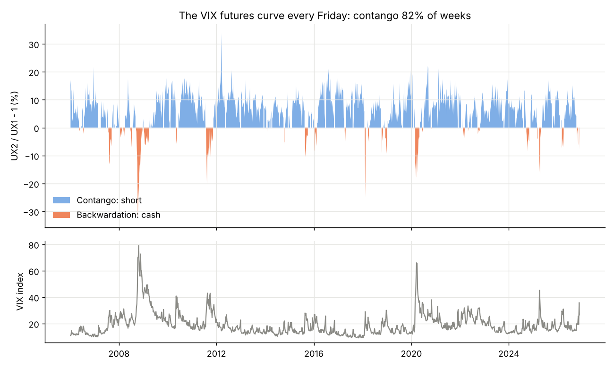
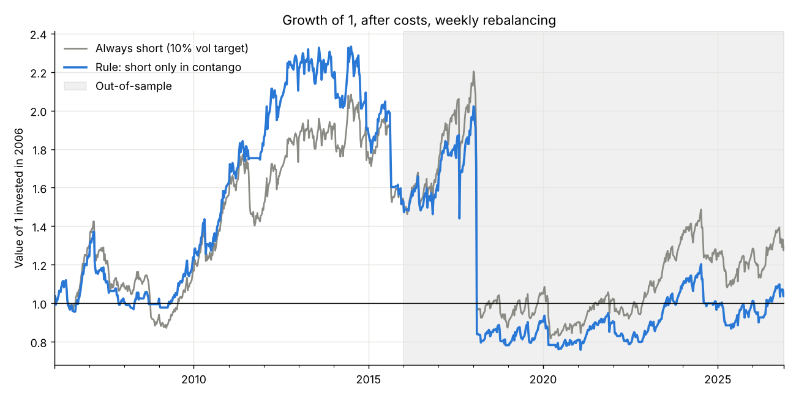
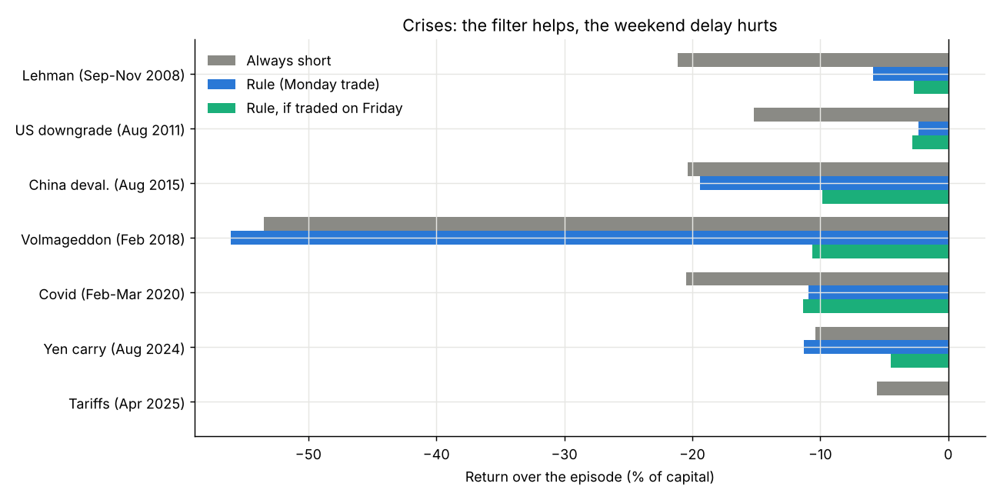
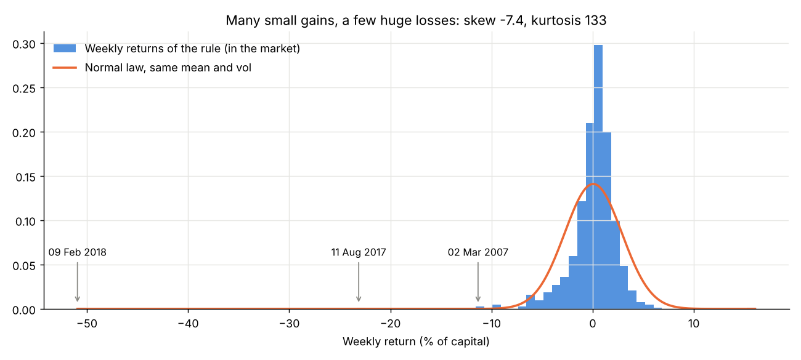
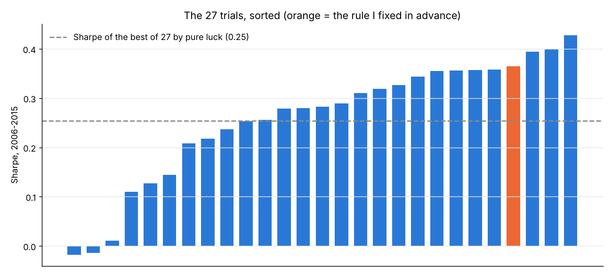
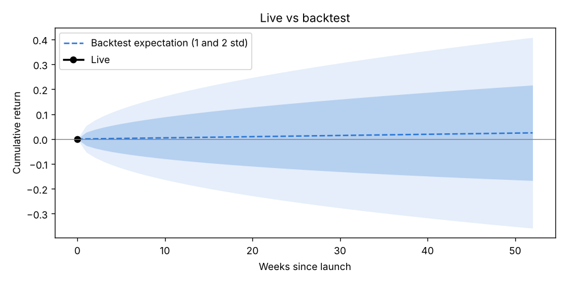

# Short VIX Futures: 20-Year Backtest and Live Track Record

I test one of the most crowded trades in hedge funds: **selling VIX futures to collect the
volatility risk premium**. Most of the time the VIX futures curve slopes up, and a short
position earns money every week as the future slides down to the spot VIX. Once in a while
the VIX doubles in a day and the trade loses years of gains.

Three questions drive the project:
1. **Is the Sharpe real, or a mirage of rare crashes?** I answer with the t-stat, the skewness and the Deflated Sharpe Ratio, and I log every version I try.
2. **Does a curve filter protect against crashes?** I compare the rule with a book that is always short, crisis by crisis.
3. **Does it survive in real time?** From 30 November 2026, I run a 1 million USD paper book and publish it every weekend, before the market opens ([LIVE.md](LIVE.md)).

| After costs, weekly trading | 2006-2015 (in-sample) | 2016-2026 (out-of-sample) | 2006-2026 |
|---|---|---|---|
| Return per year | 5.4% | -0.1% | 2.5% |
| Volatility | 14.7% | 22.5% | 19.2% |
| **Sharpe** | **0.37** | **-0.01** | **0.13** |
| t-stat | 1.2 | 0.0 | 0.6 |
| Max drawdown | -35% | -62% | -67% |
| Skew | -1.4 | -8.4 | -7.4 |

## 1. The strategy

Every Friday, at the CBOE settlement:
- **Signal**: if the 2nd VIX future is above the 1st (UX2 > UX1, contango), I am short the front future next week. If not, I stay in cash.
- **Contract**: the 1st future, or the 2nd if the 1st expires before the next Friday.
- **Size**: notional = 10% / volatility of that future over the last 20 days, capped at 100% of capital.
- **Timing**: the trade is done at **Monday's settlement**. This is what I can do live: I get the Friday prices at the weekend, commit the position on Sunday, and trade on Monday. No look-ahead.
- **Costs**: one tick (0.05 point, 50 USD) per contract traded; a roll counts as two trades.

**Why should it work?** The VIX measures the volatility the market expects on the S&P 500
over the next 30 days. Investors pay to be protected against a crash, so the futures usually
trade **above** the spot VIX: the curve is in **contango** on 82% of Fridays since 2006. As
a future gets closer to expiry, it converges to the spot, and the short earns this slide.
The seller is an insurer: many small premiums, and a big claim in a crisis. When the market
panics, the curve inverts (**backwardation**): the fear is now, so the near future jumps
above the next one. That is the moment to step aside.



## 2. Data

- **Backtest and live**: [CBOE](https://www.cboe.com/us/futures/market_statistics/historical_data/), the daily settlement of every VIX future since 2004 (276 contracts). Free and public. I rebuild the 1st and 2nd futures (UX1, UX2) myself.
- **Other series**: VIX index (FRED), S&P 500 (Yahoo and FRED).
- **Checks with Bloomberg**: my UX1 and UX2 match the Bloomberg generic futures to the cent in February 2018, March 2020 and August 2024 (for example UX1 = 27.175 and UX2 = 20.425 on 9 February 2018). My long front future also has a 0.91 monthly correlation with the S&P 500 VIX Short-Term Futures index (SPVXSTR), the index behind the VIX ETPs.
- **Two fixes**: before March 2007 the CBOE quoted the futures at 10 times the VIX, so I divide by 10; in early 2013 some CBOE files show a settlement of 0, so I use the close.
- Raw prices are not published (licence).

## 3. Backtest



- **2006-2017**: the trade works. The filter keeps the book out of most of 2008 and 2011. On 26 January 2018 the track record shows a Sharpe of 0.41 and a worst week of -23%.
- **5 February 2018 ("Volmageddon")**: the VIX doubles in one day and the XIV, a 1.9 billion USD short VIX ETP, is liquidated. My book loses **51% in one week**.
- **2018-2026**: the trade earns again, but never recovers the loss.



The filter does its job **when the crisis is slow**: in 2008, 2011 and 2020 the curve inverts
while the VIX is still rising, and the book is in cash for most of the damage (-6% vs -21%
for a book that is always short in 2008). It is useless **when the shock comes from a calm
market**. In February 2018 the curve inverts on Friday 2 February (15.63 > 14.98), so the
signal is right, but I only trade at Monday's close: UX1 is at 33.2, and the short opened
at 13.5 has lost 146%.

## 4. Is the Sharpe real?



A normal law would never produce a -51% week with 19% annual volatility. The weekly returns
have a **skew of -7.4** and a **kurtosis of 133** (3 for a normal law): the profile of
selling insurance.

| Measure | Question | Formula | My result |
|---|---|---|---|
| Sharpe | How much return per unit of risk? | mean / std × √52 | 0.37 (2006-2015) |
| t-stat | Could the true mean be zero? | Sharpe × √years | 1.2 |
| Deflated Sharpe | Same, knowing I tried 27 versions and the returns have fat tails | Bailey and Lopez de Prado (2014) | **0.63** |

**t-stat.** Above 2, a result is unlikely to be chance. Even in-sample the rule is at 1.2:
ten years of a Sharpe of 0.37 cannot be told apart from zero.

**Deflated Sharpe Ratio.** I try 27 versions on 2006-2015 only: contango threshold (0%, 2%,
5%) × how contango is measured (UX2 vs UX1, UX1 vs spot VIX, both) × volatility window (10,
20, 60 days). All of them are in [`results/trials_log.csv`](results/trials_log.csv). The best
of 27 useless strategies would show a Sharpe of **0.25** by luck. My rule shows 0.37, only
slightly better. The fat-tail correction is small here (0.88 to 0.87), because the formula
multiplies the skew by the Sharpe, and the Sharpe is already small. The result is a
probability of **0.63** that the true Sharpe is positive, far from the 0.95 target.
**The rule does not pass.**



The rule I fixed in advance (orange) ranks 4th out of 27. The best trial (Sharpe 0.43) uses a
60-day volatility window. I do not switch to it: choosing the best trial after the fact is
exactly what the Deflated Sharpe punishes.

## 5. Is it a new alpha?

I regress the weekly P&L on the weekly return of the S&P 500:

| Regression | Alpha per year | t-stat | Beta S&P 500 | t-stat | R² |
|---|---|---|---|---|---|
| S&P 500 | **-2.0%** | -0.5 | **0.45** | 15.0 | 17% |

Short VIX is mostly a leveraged long position in stocks that loses more than stocks in a
crash. Once the equity exposure is removed, nothing is left. For a hedge fund, the premium
is real, but it pays for a risk that any equity investor already holds.

## 6. The cost of trading once a week

| 2006-2026 | Traded at Monday's settlement (live) | Traded at Friday's settlement |
|---|---|---|
| Sharpe | 0.13 | **0.34** |
| Max drawdown | -67% | -29% |
| February 2018 | -56% | -11% |

The same rule, traded at the Friday settlement, has more than twice the Sharpe. I cannot
trade on Friday live, because I only get the prices after the close, so this column only
measures what the weekend delay costs. A desk runs this trade daily, with stop-losses.

**The trap of volatility targeting.** The size is 10% divided by recent volatility. Before a
shock the market is calm, recent volatility is low, so the position is **at its biggest**:
39% of capital at the end of January 2018, 61% in August 2017. The book targets 10%
volatility and ends with 19%, because the risk of this trade is not in its recent volatility.

## 7. Live track record

The rules are frozen in [RULES.md](RULES.md). Every weekend I download the CBOE settlements
of Friday, compute the P&L of the week and the position for Monday, and commit them
**before Sunday midnight, Paris time**, when VIX futures reopen. The commit time stamp
proves the position was chosen before the market moved. At the end of each month, I add a
short letter to investors.

| Since launch (30 Nov 2026) | |
|---|---|
| Weeks | 0 |
| Cumulative P&L | - |
| NAV (start 1,000,000 USD) | - |
| Worst week | - |

**First position (Friday 27 November 2026)**: UX1 22.84 > UX2 22.79, the curve is in slight
backwardation (-0.2%), so the book is **in cash** for the week of 30 November.



The shaded cone is what the backtest expects over the first year; the black line is the live
book, added every week. After a few weeks a t-stat means nothing: three months at a Sharpe
of 0.4 give t = 0.2. The real question is whether the live P&L stays inside the range the
backtest expects.

**Latest week and full history:** [LIVE.md](LIVE.md).

## How to run

```
pip install -r requirements.txt
python scripts/download_cboe.py   # every weekend (Google Colab): CBOE settlements -> data/cboe/
python backtest.py                # backtest, statistics and charts in results/
python live.py week               # every weekend: P&L of the week
python live.py positions          # every weekend: position for Monday
```

References: Whaley (2013), *Trading Volatility: At What Cost?* Simon and Campasano (2014),
*The VIX Futures Basis: Evidence and Trading Strategies*. Bailey and Lopez de Prado (2014),
*The Deflated Sharpe Ratio*. Harvey, Liu and Zhu (2016), *...and the Cross-Section of Expected
Returns*. Moreira and Muir (2017), *Volatility-Managed Portfolios*.
